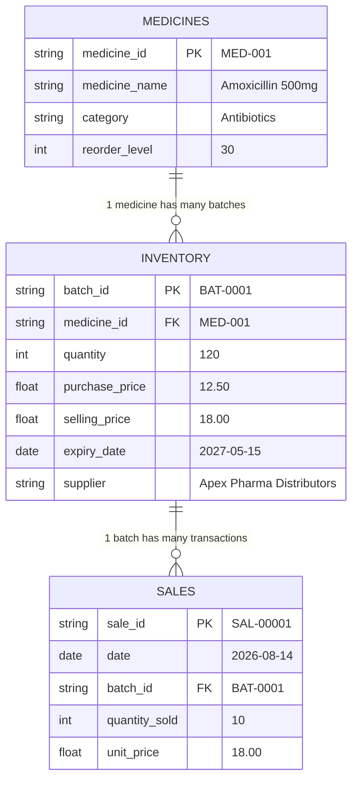

# PharmaTrack — Smart Pharmacy Inventory, Sales & Expiry Analytics System

PharmaTrack is an educational college-level data analytics and inventory intelligence platform engineered for pharmacy operations. It analyzes medicine inventory, sales transactions, and batch expiry data to prevent stockouts, minimize financial exposure from expiring medicines, calculate true batch gross margins, and generate rule-based replenishment suggestions.

> [!NOTE]
> **Academic Mini-Project Notice:** PharmaTrack is an educational analytical simulation. It is not connected to a live hospital or pharmacy dispensing system and should not be used as an automated clinical dispensing or procurement engine without licensed pharmacist review.

---

## 🏛️ Project Architecture & Directory Layout

```text
pharmatrack/
│
├── app.py                         # Executive Overview Streamlit dashboard entrypoint
├── start.bat                      # Windows 1-click environment setup & application launcher
├── config.py                      # Central configuration, file paths, schemas, and thresholds
│
├── data/
│   ├── raw/                       # Raw ingested or synthetic CSV datasets
│   │   ├── medicines.csv          # Catalog of medicines and safety reorder levels
│   │   ├── inventory.csv          # Batch-level stock, costs, and expiry dates
│   │   └── sales.csv              # Historical transaction records
│   └── processed/                 # Cleaned, validated, and normalized CSV datasets
│
├── src/
│   ├── __init__.py                # Package root
│   ├── data/                      # Ingestion, validation, and synthetic data generation
│   │   ├── generator.py           # Reproducible synthetic dataset generator (fixed seed)
│   │   ├── validator.py           # Relational schema validation & anomaly reporter
│   │   └── loader.py              # Ingestion, type-coercion & unified transaction merging
│   ├── inventory/                 # Inventory management & stock valuation
│   │   └── service.py             # Usable stock exclusion, reorder alerts & replenishment
│   ├── analytics/                 # Sales velocity & financial analytics
│   │   └── service.py             # Batch-level COGS profit, periodic summaries & trends
│   ├── expiry/                    # Expiry risk classification & FEFO recommendations
│   │   └── service.py             # Expiry tiering, financial exposure & stock rotation
│   └── visualization/             # Modular Matplotlib & Seaborn chart engine & clinical theme
│       ├── charts.py              # Isolated statistical and operational visual plots
│       ├── state.py               # Central data cache, sidebar loaders & CSV uploaders
│       └── theme.py               # Centralized clinical design system tokens & UI styles
│
├── pages/                         # Interactive Multi-Page Streamlit Dashboard
│   ├── 1_Inventory.py             # Searchable stock tables, categories & low-stock alerts
│   ├── 2_Sales_Analytics.py       # Revenue trends, top-sellers, category profit & correlations
│   ├── 3_Expiry_Tracking.py       # Value-at-risk, expiry tiers, FEFO rotation queue
│   ├── 4_Replenishment.py         # Demand forecasting & reorder recommendations
│   └── 5_Reports.py               # Centralized audit reports download hub
│
├── reports/
│   └── exports/                   # Exported CSV audit reports and analytical summaries
│
├── tests/                         # Comprehensive Pytest Suite (56 tests)
│   ├── __init__.py
│   ├── test_setup.py              # Phase 0 dependencies, schemas & smoke tests
│   ├── test_data.py               # Phase 1 data ingestion, generation & validation tests
│   ├── test_inventory.py          # Phase 2 inventory management, valuation & alerts tests
│   ├── test_analytics.py          # Phase 3 sales, revenue, COGS, rankings & trends tests
│   ├── test_expiry.py             # Phase 4 batch expiry classification, FEFO & exposure tests
│   ├── test_visualization.py      # Phase 5 visualization routines and page syntax tests
│   └── test_integration.py        # End-to-end integration and error robustness tests
│
├── .gitignore                     # Git exclusions for Python caches, venvs, and exports
├── pytest.ini                     # Pytest configuration settings
├── README.md                      # Project documentation and quickstart guide
└── requirements.txt               # Dependency specification
```

---

## 🛠️ Technology Stack & Analytical Roles

| Library | Version Requirement | Core Role in PharmaTrack |
|---|---|---|
| **Python** | `>= 3.11` | Core runtime language and system architecture |
| **Pandas** | `>= 2.2.0` | Ingestion, cleaning, date parsing, joins, grouping, and aggregations |
| **NumPy** | `>= 1.26.0` | Vectorized arithmetic, financial valuations, and statistical distributions |
| **Matplotlib** | `>= 3.8.0` | Time-series line charts, comparative grouped bars, and stock alert levels |
| **Seaborn** | `>= 0.13.0` | Transaction basket size box plots, correlation heatmaps, and risk distributions |
| **Streamlit** | `>= 1.35.0` | Responsive multi-page web dashboard and interactive UI |
| **Pytest** | `>= 8.0.0` | Automated test suite verifying business invariants and workflows |

---

## 📊 Sample Data Specification & Relationships

PharmaTrack uses three relational CSV tables with referential integrity constraints:



### Table Definitions
1. **`medicines.csv`** (Medicine Catalogue Master)
   - `medicine_id`: Unique primary key (`MED-001` through `MED-025`).
   - `medicine_name`: Formulation name and dosage strength.
   - `category`: Therapeutic pharmacological classification (e.g., *Antibiotics*, *Analgesics*, *Cardiovascular*, *Antidiabetic*).
   - `reorder_level`: Safety inventory threshold triggering replenishment.

2. **`inventory.csv`** (Batch-Level Inventory)
   - `batch_id`: Unique batch identifier (`BAT-0001` through `BAT-0071`).
   - `medicine_id`: Foreign key reference to `medicines.csv`.
   - `quantity`: Physical units currently in stock.
   - `purchase_price`: Wholesale acquisition cost per unit ($ COGS basis).
   - `selling_price`: Default retail dispensary selling price per unit.
   - `expiry_date`: Manufacturer expiration date (`YYYY-MM-DD`).
   - `supplier`: Approved pharmaceutical distributor name.

3. **`sales.csv`** (Sales Transactions)
   - `sale_id`: Unique transaction primary key (`SAL-00001` through `SAL-00430`).
   - `date`: Transaction timestamp date (`YYYY-MM-DD`).
   - `batch_id`: Foreign key reference to the exact batch dispensed from `inventory.csv`.
   - `quantity_sold`: Integer units sold in the transaction ($> 0$).
   - `unit_price`: Realized retail price per unit at sale time.

---

## 🚀 Key Functional Modules & Business Invariants

### 1. Ingestion & Validation (`src/data/`)
- **Strict Referential Integrity:** Verifies unique primary keys and guarantees that all `inventory.medicine_id` values reference valid medicines and `sales.batch_id` values reference valid batches.
- **Stock Depletion Consistency:** Validates that cumulative historical sales do not exceed batch acquisition quantities.
- **Reproducible Generator:** Generates 25 medicines, 71 batches, and 430 sales transactions using a fixed random seed (`seed=42`).

### 2. Inventory Management (`src/inventory/`)
- **Usable vs. Physical Stock Invariant:** Batches whose expiry date is strictly before the reference date (`expiry_date < as_of_date`) are classified as expired and **strictly excluded** from usable stock and dispensing queues.
- **Accurate Inventory Valuation:** Computes purchase-cost valuation for total physical units, usable units, and expired stock holding value.
- **Multi-Level Low-Stock Alerts:** Identifies stockouts and stock deficits based on usable stock relative to configured reorder levels.

### 3. Sales & Revenue Analytics (`src/analytics/`)
- **True Batch-Level COGS Profit:** Calculates gross profit using the **actual historical purchase price** of the specific batch sold:
  $$\text{COGS} = \text{quantity sold} \times \text{batch purchase price}$$
  $$\text{Gross Profit} = \text{Revenue} - \text{COGS}$$
  Revenue is never equated to profit, and current inventory costs are never substituted for historical batch purchase costs.
- **Periodic Summaries:** Aggregates transactions into daily, weekly, and monthly summaries with average order value (AOV) and gross margin percentages.
- **Velocity & Stagnation Analysis:** Identifies top revenue drivers and slow-moving or dormant medicines holding idle capital.
- **Demand Projections:** Calculates moving average velocity with explicit disclosures on statistical projection limitations.

### 4. Expiry & Wastage Risk Analysis (`src/expiry/`)
- **Strict Invariant Classification:**
  - `Expired`: Days remaining $< 0$. **An expired batch is never classified as near expiry.**
  - `Expiring Today`: Days remaining $== 0$.
  - `Near Expiry`: $0 \le \text{days remaining} \le \text{threshold}$ (configurable slider, default 30 days).
  - `Safe / Healthy`: Days remaining $>$ threshold.
- **Value-at-Risk (Exposure):** Estimated as $\text{Remaining Quantity} \times \text{Batch Purchase Cost}$. Explicitly disclosed as potential operational exposure, not realized financial loss.
- **FEFO (First-Expiry-First-Out):** Sequences usable batches by earliest expiry date first, generating prioritized dispensing recommendations (`Priority #1`, `Priority #2`, front-shelf rotation) while quarantining expired batches.
- **Verified Wastage Analysis:** Never claims realized wastage occurred unless verified wastage incident records exist in the dataset.

### 5. Visualizations & Streamlit Dashboard (`src/visualization/`, `pages/`)
- **Executive Overview (`app.py`):** 5 KPI metric cards, daily revenue trend, expiry risk bar chart, and urgent alert tables.
- **Inventory Page (`pages/1_📦_Inventory_Management.py`):** Searchable stock tables, stock vs. reorder bar chart, category/supplier filters, and CSV downloads.
- **Sales Analytics Page (`pages/2_💰_Sales_Analytics.py`):** Date range pickers, periodic summaries, top-sellers bar chart, category profit comparison, Seaborn boxplot & correlation heatmap.
- **Expiry Risk Page (`pages/3_⚠️_Expiry_Risk.py`):** Near-expiry threshold slider, financial exposure metrics, Seaborn expiry distribution, FEFO queue.
- **Replenishment Page (`pages/4_🔄_Replenishment.py`):** Lead time, safety stock multipliers, runout days, and reorder recommendation tables.
- **Reports Hub (`pages/5_📥_Reports.py`):** Centralized portal for instant CSV generation and download of all 8 audit reports.

---

## ⚡ Quickstart Launcher (Windows 1-Click)

On Windows, you can launch the complete application with a single command or double-click using [`start.bat`](file:///C:/Users/shrey/.t3/scratch/2026-10-25-hii-lets-work-on-a-1a388659/start.bat):

```cmd
start.bat
```

`start.bat` automatically:
1. Detects Python 3.11+.
2. Creates the isolated virtual environment (`.venv`) if not present.
3. Activates the environment.
4. Installs and updates all dependencies from `requirements.txt`.
5. Verifies and generates synthetic sample datasets in `data/raw/` if missing.
6. Launches the interactive Streamlit dashboard at `http://localhost:8501`.

---

## ⚙️ Step-by-Step Manual Setup & Execution Commands

### 1. Clone & Navigate to Project Directory
```bash
git clone https://github.com/Shreyashr41/random.git
cd random/2026-10-25-hii-lets-work-on-a-1a388659
```

### 2. Create and Activate Virtual Environment
**On Windows (PowerShell):**
```powershell
python -m venv .venv
.\.venv\Scripts\Activate.ps1
```

**On Linux / macOS (Bash):**
```bash
python3 -m venv .venv
source .venv/bin/activate
```

### 3. Install Dependencies
```bash
pip install --upgrade pip
pip install -r requirements.txt
```

### 4. Generate Sample Datasets
Generate fresh, reproducible sample data with relational integrity:
```bash
python -m src.data.generator
```

### 5. Run Automated Tests
Execute the full test suite with detailed output:
```bash
pytest -v
```
To run tests with code coverage:
```bash
pytest --cov=src -v
```

### 6. Launch the Interactive Streamlit Dashboard
```bash
streamlit run app.py
```
Streamlit will start and open your default web browser at:
`http://localhost:8501`

---

## 📸 Presentation & Screenshot Capture Instructions

To prepare screenshots for project viva presentations or lab reports:

1. **Executive Overview (`app.py`):**
   - Run `streamlit run app.py`.
   - Capture the top 5 KPI cards (*Total Usable Stock*, *Revenue*, *Gross Profit*, *Low-Stock Alert*, *Batches Near Expiry*).
   - Capture the Matplotlib revenue trend line and the Seaborn expiry classification bar chart.
2. **Inventory Stock Distribution (`pages/1_📦_Inventory_Management.py`):**
   - Navigate to the **Inventory Management** page from the sidebar.
   - Filter by therapeutic category (e.g., *Antibiotics*).
   - Capture the horizontal bar chart showing usable stock levels vs. safety reorder thresholds.
3. **Sales Analytics & Correlation (`pages/2_💰_Sales_Analytics.py`):**
   - Navigate to **Sales Analytics**.
   - Adjust the date range picker.
   - Capture the Seaborn boxplot illustrating basket sizes and the correlation heatmap.
4. **FEFO Stock Rotation (`pages/3_⚠️_Expiry_Risk.py`):**
   - Navigate to **Expiry Risk**.
   - Adjust the near-expiry slider (e.g., set to 45 days).
   - Capture the FEFO stock rotation table showing prioritized dispensing and quarantined expired batches.
5. **Reports Download Hub (`pages/5_📥_Reports.py`):**
   - Navigate to **Reports Hub**.
   - Click **Download CSV** on any audit table to demonstrate data export capabilities.

---

## ⚠️ Documented Architectural Limitations

1. **Simulated Pharmacy Environment:** PharmaTrack is an educational analytical project. It is not connected to a live hospital electronic health record (EHR) or pharmacy dispensary robot.
2. **Moving-Average Demand Projections:** The demand forecasting model uses historical rolling averages and simple lead-time multipliers. It does not account for complex seasonal epidemic surges, prescription doctor shifts, or macro supply shortages.
3. **Inventory Reorder Advice:** All reorder suggestions are explicitly flagged as analytical recommendations, not automated purchase orders. Final purchasing decisions require human pharmacist verification.
4. **No Unrecorded Wastage Assumptions:** Financial wastage is only computed when explicit wastage records exist. Potential expiry exposure is documented as operational risk, not realized accounting loss.

---

## 🔧 Troubleshooting Guide

| Issue | Cause | Recommended Solution |
|---|---|---|
| `ModuleNotFoundError: No module named 'src'` | Working directory is not project root | Ensure your terminal is in the project directory before running `pytest` or `streamlit run app.py`. |
| `Cannot load script: Execution_Policies` (Windows) | PowerShell execution policy restricts scripts | Run `Set-ExecutionPolicy -Scope Process -ExecutionPolicy Bypass` in PowerShell before activating `.venv`. |
| `Port 8501 is already in use` | Another Streamlit instance is running | Launch on an alternative port: `streamlit run app.py --server.port 8502`. |
| `MatplotlibDeprecationWarning: vert: bool` | Matplotlib 3.11+ deprecation in Seaborn | Harmless upstream library warning; does not affect chart rendering or analytical accuracy. |
| `Missing required dataset medicines.csv` | Sample datasets have not been generated | Run `python -m src.data.generator` to create raw CSV files in `data/raw/` or run `start.bat`. |
| `UnicodeEncodeError: 'charmap'` (Windows CLI) | Non-ASCII characters in Windows console | The codebase uses clean ASCII output strings (`[PASSED]`, `[ALERT]`) to ensure full Windows console compatibility. |
